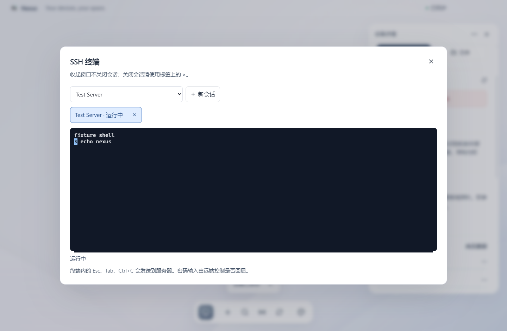
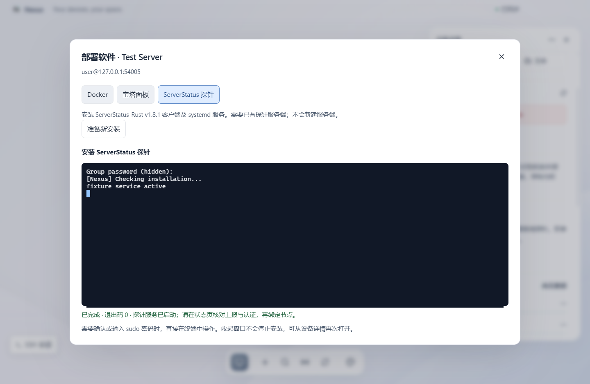

<p align="center"></p>

# Nexus

Nexus 是一个管理个人服务器和设备的桌面应用。把设备放在同一张画布上，查看监控、连接 SSH、传输文件，也可以直接在服务器上安装软件。

支持 Windows 10/11 x64。设备配置和凭据保存在本机，不需要注册账户。

[下载](https://github.com/YRRLYB/Nexus/releases) · [软件部署](docs/INSTALL.md) · [SSH 连接](docs/SSH.md) · [探针安装](docs/PROBE-INSTALL.md) · [更新记录](CHANGELOG.md)


## 安装

从 Releases 下载 `Nexus-0.5.0-Windows-x64.exe`，打开即可。程序未签名，Windows 可能显示安全提示；运行前请核对发布页的 SHA-256。

应用数据保存在 `%APPDATA%/Nexus/`。升级时退出旧版，再打开新版，设备和布局会保留。备份时先退出程序，再备份整个数据目录。加密凭据绑定当前系统账户，不能通过复制数据库迁移到另一台电脑。

## 使用

- 添加设备，填写 SSH 地址、端口、用户名和密码或私钥，也可使用 SSH Agent。
- 拖动设备调整位置；拖动空白处平移，滚轮缩放。布局和视角会自动保存。
- 点击设备打开详情，查看状态、连接终端或打开文件管理。`Ctrl+K` 查找设备，`F11` 切换全屏。
- 已有 ServerStatus 状态站时，在「探针与连接」填写 `/json/stats.json` 地址，导入节点后补全 SSH 配置。

### SSH 终端

点击「SSH 连接」打开内置终端，不需要安装本机 OpenSSH Client。支持密码、私钥和 SSH Agent，以及多会话、重新连接和窗口尺寸同步。

收起终端窗口不会断开连接；点击「SSH 会话」可返回。关闭标签会结束对应会话。终端内的 Esc、Tab、Ctrl+C 会发送到服务器。

首次连接需要核对主机指纹，密钥变化时拒绝连接。Windows、macOS 和 NAS 也可以连接，但目标设备需要启用 SSH 服务。配置方法见 [SSH 教程](docs/SSH.md)。



### 文件管理

文件面板左侧是本机，右侧是远程目录。双击进入目录，可上传、下载、新建目录和重命名。删除需要确认，远程目录只允许删除空目录。

文件和目录传输会进入队列，可以取消或重试。目录递归传输，不跟随符号链接；已有目标不会被覆盖。下载时选择保存文件夹，保留源文件或目录名称。收起面板后任务继续运行，退出应用会中断任务。

点击预览按钮可查看 PNG、JPEG、GIF、WebP 和 UTF-8 文本。图片上限 8 MB，文本显示前 256 KB；SVG、HTML 按纯文本显示，不执行其中的代码。


### 服务器软件部署

Linux 设备详情中的「部署软件」支持 Docker、宝塔 Linux 面板 12 稳定版和 ServerStatus-Rust 探针。

选择软件后，先检查服务器的系统、架构、权限和已有安装，再查看脚本来源与内容。确认后通过 SSH 执行，安装日志和交互提示显示在终端中，脚本结束后检查运行状态。sudo 密码和探针组密码在终端提示中输入，不放进安装参数。

这不是只复制安装命令。安装会修改服务器的软件包、服务或防火墙，请先做好备份；中断不会回滚已有改动。已有安装不会被覆盖或升级。支持范围和注意事项见 [部署说明](docs/INSTALL.md)。



### 监控与运行内容

监控读取 ServerStatus-Rust 的现有状态接口，展示 CPU、内存、磁盘、网络速率和在线状态。Nexus 不包含探针服务端；客户端自动部署与手动安装方法见 [探针教程](docs/PROBE-INSTALL.md)。

Linux 设备详情会读取进程、服务、容器、端口和定时任务，整理运行内容及项目线索。采集为只读操作，不安装远程组件，不采集进程参数、环境变量值或项目配置。结果缓存 5 分钟，可手动刷新；工具缺失或权限不足会单独提示。

## 设备支持

| 目标设备    | SSH / SFTP            | 快捷操作                        | 软件部署                         |
| ----------- | --------------------- | ------------------------------- | -------------------------------- |
| Linux / VPS | 支持                  | 按 systemd、OpenRC 等工具适配   | 检查实际发行版、架构和权限后开放 |
| Windows     | 需启用 OpenSSH Server | PowerShell 服务、日志和系统信息 | 不提供 Linux 安装入口            |
| macOS       | 需启用远程登录        | launchctl、系统日志和版本信息   | 不提供 Linux 安装入口            |
| NAS         | 需在管理界面启用      | 按已填写的实际系统适配          | 专有系统请使用厂商应用管理器     |

重启和关机仅对启用此能力的 Linux 设备开放，需要二次确认。监控数据、运行识别和文件传输都依赖目标设备的实际权限。

## 凭据与日志

密码、私钥、私钥口令和探针接口 Token 使用系统凭据加密，普通设备配置不包含这些内容。复制密码需要确认，剪贴板内容未改变时会在 30 秒后清除。

终端记录仅保留在内存中，重新打开窗口显示最近约 1 MB 输出，不保存为日志文件。远端程序可能主动输出敏感信息，截图或分享终端内容前请自行检查。

## 开发

使用 Node.js 24 和 npm：

```sh
npm ci
npm run dev
npm run check
npm test
npm run test:ui
npm run package
npm run test:package
```

技术栈为 Electron、React、TypeScript、ssh2 和 sql.js。[架构说明](docs/ARCHITECTURE.md) 和 [测试记录](docs/ACCEPTANCE.md) 位于 `docs/`。

截图使用本地测试节点。自动测试不代表已在各发行版的生产服务器上完成安装验收。
