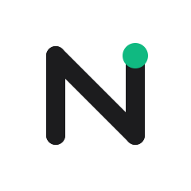
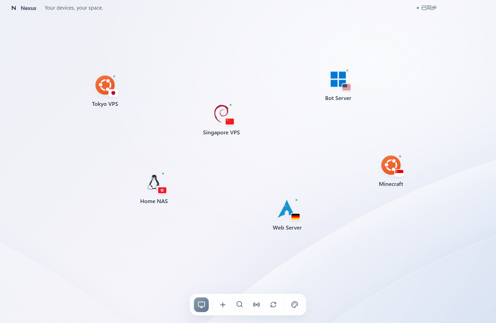
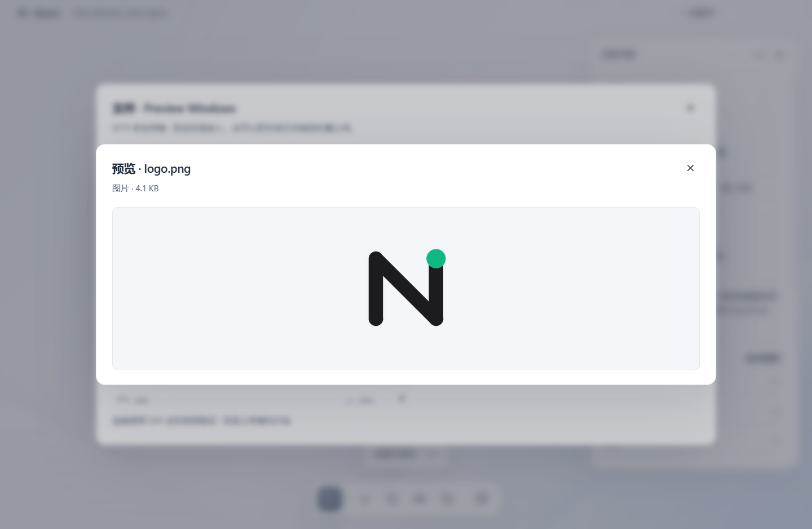
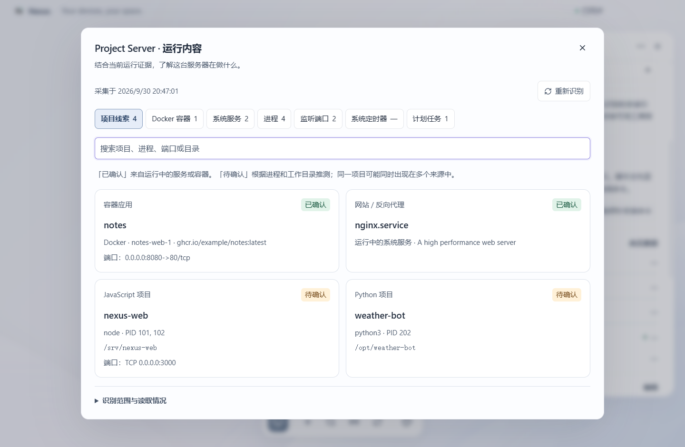

<p align="center"></p>

# Nexus

**Your devices, your space.** 一个可以自由组织和操作你所有设备的可视化工作空间。

本项目根据 [项目方案](Nexus_项目方案.md) 实现第一阶段能力，当前版本 **0.4.0**。首页是可自由平移和缩放的设备空间。探针沿用现有 ServerStatus-Rust。

**Nexus 不是又一个孤立的 SSH 客户端**：把个人服务器、VPS 和家用设备放进同一张桌面，在设备详情里查看监控、识别运行项目、连接 SSH、管理和预览文件。Windows 桌面优先，Linux 服务器优先；Windows / macOS / NAS 按各自能力适配。无账号注册、无云端密码上传。

[安装与 Docker 脚本](docs/INSTALL.md) · [探针自动 / 手动安装](docs/PROBE-INSTALL.md) · [Windows SSH 教程](docs/SSH.md) · [下一阶段](docs/ROADMAP.md) · [版本记录](CHANGELOG.md)



截图由真实桌面界面测试生成，使用本地测试节点，不包含真实服务器连接资料。

## 运行

Windows 10/11 x64：从 [Releases](https://github.com/YRRLYB/Nexus/releases) 下载已发布版本，或自行打包得到 `release/Nexus-0.4.0-Windows-x64.exe`。退出旧版后打开新文件。该文件为便携启动程序，首次解压启动需要几秒。应用数据仍保存在当前账户的 `%APPDATA%/Nexus/`，不会跟随 exe 移动。升级保留原有设备、凭据和设备坐标。

开发环境需要 Node.js 22 或更新版本，建议 Node.js 24：

```powershell
npm.cmd ci
npm.cmd run dev
```

```powershell
npm.cmd run check       # TypeScript 检查
npm.cmd test            # 探针、数据库、SSH/SFTP 协议测试
npm.cmd run test:ui     # 构建后运行 Electron 界面测试
npm.cmd run package     # 构建 Windows x64 便携程序
npm.cmd run test:package # 打包后启动验证与私有文件排除检查
```

Electron 下载不畅时，可以在当前 PowerShell 会话设置 `ELECTRON_MIRROR=https://npmmirror.com/mirrors/electron/` 后重试依赖安装。不会修改系统环境变量。

## 第一次使用

1. 点击底部程序坞的「探针与连接」。默认接口来自现有状态站：`https://server.yrrlyb.top/json/stats.json`，可更改为自己的实例。
2. 选择发现的节点，点击「导入所选设备」。也可直接「添加设备」，手动绑定探针。
3. 编辑每台设备的 IP、SSH 端口、用户名和认证方式。监控接口不公开连接 IP，无法自动可靠地补齐这些信息。
4. 拖动图标安排设备，点击图标展开浮动详情。系统图标右下角显示所在地旗帜，右上角显示状态点；所在地默认跟随探针，也可在编辑设备时手动选择。设备名称、详情和各面板文字已放大。
5. 「SSH 连接」打开 Windows PowerShell 并执行本机 OpenSSH。密码和私钥口令在终端交互输入；可以复制密码，或使用系统 SSH Agent。应用不把密码放进命令行。
6. 「文件」使用内置 SFTP，支持浏览本地 / 远程目录、上传、下载、拖拽文件上传、删除文件或空目录、重命名、新建文件夹。首次连接需核对 SSH 主机指纹；点击文件旁的眼睛可以预览图片 / 文本，不必先下载。

## Windows 能使用 SSH 吗？

**可以。** 本机连接服务器需要 OpenSSH **Client**；让其他电脑连接 Windows 需要在目标机安装 OpenSSH **Server**。设置面板会检测 `ssh -V` 并给出启用方法。内置 SFTP / 快捷操作使用 ssh2，不依赖本机系统 ssh.exe。详细步骤和排障见 [SSH 教程](docs/SSH.md)。

| 目标设备    | 快捷操作                                                 | 识别 / 安装 / 电源边界                                  |
| ----------- | -------------------------------------------------------- | ------------------------------------------------------- |
| Linux / VPS | Docker、systemd / OpenRC / service、journalctl / logread | Linux 运行识别；Docker / 探针安装引导；确认后电源操作   |
| Windows     | Docker、PowerShell 服务、事件日志、系统版本              | 不执行 Linux 命令；不开启 Linux 自动部署 / 电源操作     |
| macOS       | Docker、launchctl、系统 log、sw_vers                     | 开启远程登录后使用 SSH / SFTP；不执行 Linux 电源命令    |
| NAS         | SSH / SFTP；按已填写的实际 OS 适配                       | 未知系统保守降级，默认无电源操作；专有 NAS 使用厂商工具 |

## SSH 文件预览

- 在「文件」面板点击眼睛：远程文件通过经过指纹验证的 SFTP 读取，本地文件也可预览。
- PNG / JPEG / GIF / WebP 图片最大 **8 MB**，最多 4000 万像素、单边 16384；UTF-8 文本、代码、配置、日志只读取前 **256 KB**，截断会明确提示。
- 预览只读，不写临时下载文件、不发送内容给第三方、不执行 HTML / SVG / Markdown / JavaScript。SVG 作为纯文本查看；二进制与非 UTF-8 文本请下载后处理。
- 大图、视频、PDF、远程编辑和实时 tail 日志暂不支持。终端本身不渲染图片，预览发生在 Nexus 的文件面板。



## Docker 与同款探针安装

Linux 设备详情提供「复制 Docker 安装命令」与「复制探针安装命令」。脚本会请求确认，不在后台偷偷执行；无 `curl | sh` 的盲执行流程。Docker 已安装时不会覆盖 / 升级；探针固定 v1.8.1，支持 x86_64 / ARM64 / ARMv7，校验 ZIP 后安装受限 systemd 服务，保留节点身份。

脚本位于 `scripts/install-docker.sh` 和 `scripts/probe/install.sh`；都支持 `--dry-run`。查看 [完整安装说明](docs/INSTALL.md) 和 [没有自动部署时的手动探针教程](docs/PROBE-INSTALL.md)。探针客户端要连接你自己的服务端，不提供分组密码和私有默认配置。

## 使用设备空间

- 拖动空白处：平移画布，没有原来 0–5000 的设备坐标边界，支持负坐标。
- 滚轮：围绕鼠标缩放，范围 25%–200%；Shift + 滚轮或横向滚动：水平移动。
- 点击设备：打开浮动详情；点击空白或按 Esc：收起详情。
- `Ctrl / ⌘ + K`：打开查找，可按名称、IP、标签筛选。若结果不在当前视角，点击筛选提示旁的定位按钮。
- `F11` 或程序坞的显示器按钮：进入 / 退出沉浸全屏。未打开浮层时，Esc 也可退出。
- 程序坞的「桌面外观」：调整图标尺寸、更换雾光 / 暮色 / 暖沙背景、显示时钟、自动隐藏程序坞，以及定位全部设备。
- 自动隐藏后，鼠标靠近底部中央或点击小箭头即可召回程序坞。
- 「舒展排列」会重新安排设备位置；已有自定义布局默认保留，不自动重排。
- 视角、背景、图标尺寸等外观偏好保存在本地，重新打开自动恢复。完整设备详情仍可查看监控、SSH、文件和电源操作。

这里的“桌面”是 Nexus 自身的沉浸式全屏工作空间，当前没有接管 Windows Shell，也没有嵌入系统壁纸层。

## 已实现

- 可向任意方向移动的画布、鼠标锚定缩放、位置与视角自动保存；设备增删改、标签、备注和能力开关。
- Windows 蓝色四方块、Ubuntu、Debian、Arch、Fedora、CentOS、Rocky、AlmaLinux、Alpine、Linux、macOS 系统标识自动识别，未知系统使用自定义设备图标。
- 浮动设备详情；ServerStatus 节点发现与稳定 ID 绑定；CPU / 内存 / 磁盘、上下行速率、运行时间、探针延迟、在线状态。
- SQLite 本地存储，使用 Electron `safeStorage` 对敏感值加密。Windows 底层使用 DPAPI，绑定当前系统账户。不可用时拒绝保存敏感值。
- 密码、SSH 私钥和私钥口令、探针接口 Token 管理。编辑时留空保留凭据，勾选清除可移除凭据。普通设备 JSON 不含密码或私钥。
- 系统 OpenSSH 终端、密码 / 私钥 / SSH Agent 的内置 SFTP 认证。SFTP 与快捷命令首次连接保存经用户确认的主机指纹，密钥变化拒绝连接。
- 复制 IP、端口、用户名、密码、SSH 命令和不含凭据的设备信息；密码复制需要确认，30 秒后在内容未变化时清空剪贴板。
- Linux 重启 / 关机二次确认，约 1 分钟后执行。通过探针追踪离线 / 重新上线，5 分钟无法确认则提示超时。
- 只读快捷操作：Docker 容器列表、运行中的服务、最近 100 条系统日志、读取 Linux 系统版本。

## 服务器运行识别

保存 Linux 设备的 SSH 地址及密码 / 私钥，或选择可用的系统 SSH Agent 后，打开设备详情会自动识别当前运行内容。首次连接沿用应用的 SSH 指纹核对流程。

- 点击「查看运行内容」浏览项目线索、Docker 容器、系统服务、进程、监听端口、systemd 定时器及 cron 计划任务；支持搜索和手动重新识别。
- 容器名称、镜像和 Compose 标签，以及运行中的服务，提供已确认的运行证据；进程名称与工作目录提供待确认的项目线索。端口仅按系统返回的 PID 关联，同一项目可能出现在多个来源。
- 本次会话内缓存 5 分钟，重复打开详情复用结果；手动刷新或重新保存设备后重新读取。结果包含采集时间，刷新失败保留界面上的上次结果。
- 分析在本机完成，不依赖外部 AI，也不安装远程组件。只读命令不更改服务，不采集进程命令行参数、环境变量值或项目配置；cron 仅返回计划、用户和执行程序。
- 当前识别支持 Linux，使用 `ps`、`readlink`、`ss`、`systemctl`、`docker`、`crontab`。某项工具不存在或权限不足时单独标注；不自动提权。支持无 Docker / 非 systemd 系统的部分结果。
- 进程按 CPU 排序最多读取 160 条，服务 200 条、容器 150 条、端口 250 条、定时器 150 条；达到上限时明确标注。每项命令超时 12 秒、输出上限 160 KB。CPU 是 `ps` 提供的进程存活期间平均值。
- cron 范围为当前用户及可读的 `/etc/crontab`、`/etc/cron.d`；其他用户的个人任务、容器内项目详情和不在采集范围的进程无法保证识别。项目分类是依据线索的规则判断，不代表业务健康检查。



## 探针接入说明

提供的 ZIP 是 **Linux amd64 的探针客户端部署包**，内含 `stat_client v1.8.1`、systemd 服务和安装脚本，不是 Nexus 的桌面插件。它向 `/report` 上报，Nexus 读取服务端的 `/json/stats.json`。

- 节点绑定 `servers[].name`，显示名称用 `alias`。改变 alias 不会解绑。
- Linux 内存计数是 KiB；磁盘是 MiB。`si=true` 时磁盘按 MB 计算。
- `online4` 或 `online6` 为 true，且数据没有超过时效阈值，才显示在线。
- 接口读取失败或整个数据源过期显示「状态未知」，不会把它当成电源操作成功。
- 公共 JSON 只通过 `labels` 提供 OS 类别；完整系统版本需要手动填写或点击「读取系统版本」。完整 IP / 系统信息在上游公共 JSON 中不公开。
- ZIP 中包含私有配置及分组密码；`research/`、ZIP 和私有 env 已加入忽略规则，发布程序只允许包含构建产物和生产依赖。Nexus 不使用分组上报密码读取公开状态。

详细研究记录见 [docs/PROBE.md](docs/PROBE.md)。

## 数据、安全与边界

- 数据文件：`%APPDATA%/Nexus/nexus.sqlite`。窗口设置中的实际路径为准。关闭应用后可备份该文件；加密凭据不能直接跨 Windows 账户迁移。
- 可选环境变量 `NEXUS_DATA_DIR` 指定独立的本地数据目录，用于隔离配置或测试；打包验证也使用临时目录，与正在运行的正常工作空间分开。
- Electron 开启沙箱、上下文隔离和 CSP，关闭 Node renderer 集成、页面跳转、新窗口和页面权限。渲染进程仅能调用列出的 IPC 方法。
- SSH 终端使用系统 `known_hosts`；内置 SFTP / 快捷命令使用应用独立的主机指纹库。首次使用这两条路径可能分别要求核对指纹。
- 主机密钥变更当前拒绝连接，需核实后在数据库 `hosts` 表移除对应地址记录再重新确认。不要未经核实删除信任记录。
- SFTP 当前支持单个或多个文件传输，不递归上传 / 下载目录，不递归删除目录。大文件传输最长 30 分钟，窗口内有进度显示；传输中关闭对话框被禁用。强制退出应用会中断传输，上传中断的目标文件可能需要重新上传。
- 重启 / 关机要求 root 或相应的免密码 sudo。命令使用 `shutdown -r +1` / `shutdown -h +1`，可以在服务器执行 `shutdown -c` 取消。Nexus 不自动设置 sudo、不更新系统；安装脚本仅由用户明确审阅并执行。
- 电源跟踪只在应用运行期间保留。重启太快、监控中断或探针未绑定时不能自动确认结果，需在终端检查。
- macOS / Windows 设备可用于监控，SSH / SFTP 需目标机已启用服务；电源快捷操作仅面向 Linux。
- 当前包未配置代码签名证书。开发版和便携程序均优先支持 Windows x64。

## 目录

```text
electron/       桌面主进程、数据库、探针适配、SSH/SFTP、受限 preload
shared/         IPC 类型与运行时参数验证
src/            React 画布、详情、设备表单、设置、文件管理 UI
tests/          核心逻辑、真实本地 SSH/SFTP 协议、Electron UI 测试
scripts/        开发 / 构建、Docker 安装与公开探针部署脚本
docs/           项目说明、SSH / 部署教程、架构与验收记录
.github/        Windows / Shell CI 与版本发布工作流
release/        构建出的 Windows 程序（不入库）
research/       原探针包的本地分析副本（含私有配置，不入库）
```

下一步优先考虑内嵌终端、可恢复的文件任务和真实设备兼容验收，见 [后续路线](docs/ROADMAP.md)。当前不包含云同步、多用户、RDP/VNC 或无人确认的远程自动执行。公开源码的许可证由作者后续确认；已附带的第三方图标与旗帜许可保持不变。
